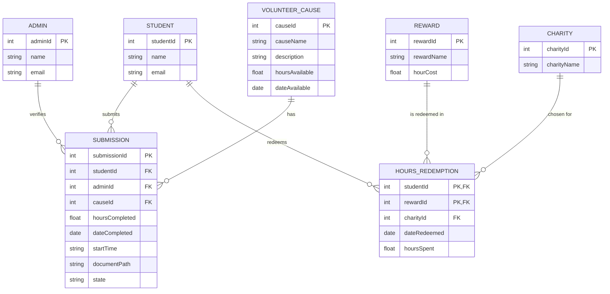

# COMP 3613 Assignment 1

Draft this file with the Guide. **Update it after every phase milestone** before you pause. The use-case diagram is a UML PNG at `docs/diagrams/use-case.png`, linked from this file as `diagrams/use-case.png` (path relative to `docs/report.md`). The model diagram is Mermaid. **Embed wireframe images** as `wireframes/<file>` (files live in `docs/wireframes/`).

Do not put your student ID in this file if you will commit it. The PDF cover adds your name and ID at export time.

## Assigned project

Student Awards (incentive system)

## Three workflows

### 1. SubmitHours (Student)

### 2. VerifyHours (Admin)

### 3. RedeemProgress (Student)

## Use case diagram

Notes:
- Actors: Student (left), Admin (right).
- VerifyHours «includes» Check Submitted Hours; extended by Check Supporting Documents.
- SubmitHours is extended by Submit Supporting Documents.
- RedeemProgress «includes» Choose Reward.
- View Hours Earned is shared: Student views their own hours, Admin views all hours.
- Assumed: no Admin approval step for redemptions (Student's choice, per student).

## Model diagram

Revised in Phase 4 from the wireframes (see revision notes below). Update again in Phase 5 when polish revises the model, and note what changed.

Notes:
- Submission holds FKs to Student, Admin, and Volunteer Cause; `state` tracks pending/verified/rejected.
- HoursRedemption is the many-to-many bridge between Student and Reward (composite PK studentId+rewardId).
- Student.totalHours is **computed** (verified submission hours minus hoursSpent in HoursRedemption), not stored.
- Admin verifies many submissions; a submission is verified by at most one admin (adminId nullable until verified).
- Many submissions can reference one Volunteer Cause (FK causeId on Submission).

Phase 4 revisions (wireframe-derived; student accepted):
- Added `submission.startTime` — Workflow 1 form field 3 (date + AM/PM); Workflow 2 shows `Start Time:`.
- Added `submission.documentPath` — Workflow 1 upload area; Workflow 2 `Participation_Form_Signed.pdf` link.
- Added `volunteer_cause.description` — cause card body text on Workflow 1.
- Added `CHARITY` (charityId, charityName) + nullable `hours_redemption.charityId` FK — Partner Charity dropdown on Workflow 3; student chose a table over a stored string (only charity conversions set it).
- Declined: splitting `Student.name` into first/last — kept as a single `name`.
- Kept `volunteer_cause.hoursAvailable` / `dateAvailable` for a future cause information page (student's note).

Phase 4 workflow clarifications (for Phase 5):
- After Confirm / Approve / Reject the user lands back at the opening screen of that workflow (1 → Account / Recent Cause Contributions; 2 → Submissions list; 3 → Rewards grid).
- Reject asks for a confirmation dialog the same way Approve does.
- Admin sees the student's **total hours earned** — computed, so show the total on the submission review card; no stored field.
- Only Charity Conversion asks for extra input; every other reward's Select goes straight to the confirmation dialog, and all selections require confirmation.

## Wireframes

Student-crafted images, embedded from `docs/wireframes/` (Phase 4).

### SubmitHours — Workflow 1

### VerifyHours — Workflow 2

### RedeemProgress — Workflow 3

Coverage:

<!-- student-build:wireframe-coverage
use_case: SubmitHours
image: docs/wireframes/Workflow 1 - Submit Hours.png
covered: yes
-->

<!-- student-build:wireframe-coverage
use_case: Submit Supporting Documents
image: docs/wireframes/Workflow 1 - Submit Hours.png
covered: yes
-->

<!-- student-build:wireframe-coverage
use_case: VerifyHours
image: docs/wireframes/Workflow 2 - Verify Hours.png
covered: yes
-->

<!-- student-build:wireframe-coverage
use_case: Check Submitted Hours
image: docs/wireframes/Workflow 2 - Verify Hours.png
covered: yes
-->

<!-- student-build:wireframe-coverage
use_case: Check Supporting Documents
image: docs/wireframes/Workflow 2 - Verify Hours.png
covered: yes
-->

<!-- student-build:wireframe-coverage
use_case: RedeemProgress
image: docs/wireframes/Workflow 3 - Redeem Progress.png
covered: yes
-->

<!-- student-build:wireframe-coverage
use_case: Choose Reward
image: docs/wireframes/Workflow 3 - Redeem Progress.png
covered: yes
-->

<!-- student-build:wireframe-coverage
use_case: View Hours Earned
image: docs/wireframes/Workflow 1 - Submit Hours.png
covered: yes
-->

`python manage.py report` also embeds any PNG/JPG still missing from `docs/wireframes/`.

## Theming

Branding preferences and how they were applied (landing / login / register).

**Preferences (Phase 5, student-stated):**

- **Colors:** Navy Blue, White, Light Blue, Gold
- **Type:** Montserrat (headings and body, weights 400–800)
- **Tone:** clear, supportive, professional without sounding stiff
- **Logo:** graduation-cap mark (gold mortarboard + tassel, cap band adapts to the surface colour) beside the wordmark **Student Awards** — the wordmark taken from the Phase 4 wireframes

**Palette (CSS tokens in `app/static/css/app.css`):**

| Token | Value | Use |
|-------|-------|-----|
| `--brand-navy` / `--brand-sidebar` | `#14395f` / `#0a1f35` | headings, landing + auth backdrop, sidebar |
| `--brand-surface` | `#ffffff` | panels and cards |
| `--brand-accent` | `#c9a227` (gold) | primary buttons, active nav, highlights |
| `--brand-accent-2` | `#5fa2da` (light blue) | gradients and secondary accents |
| `--brand-ink` / `--brand-app-bg` | `#0f2437` / `#f1f5fa` | body text on light, app page background |

**Applied:**

- Graduation-cap lockup built once as `app/templates/partials/logo.html` and included on landing, login, register, and the authenticated sidebar.
- **Landing (`/`):** navy gradient with light-blue and gold glows, wordmark + cap, supportive product copy, and three plain-language points (Submit your hours · Get verified · Redeem progress).
- **Login / register:** white panel with a gold top rule, cap lockup, supportive taglines ("Welcome back — sign in to keep earning." / "Create an account to start tracking your volunteer hours.").
- **Authenticated shell:** tokens carried through — navy sidebar, gold active item, light-blue hover, Montserrat.
- Bootstrap's default blue primary was overridden to gold with navy text for contrast.

**Starter cleanup:** the FastStarter placeholder copy on landing/login/register was replaced with Student Awards brand and product copy. `/config` and auth were kept. The starter's demo user-table page was already removed in `app.js`; `app.html` / `admin.html` remain as empty shells that the three workflow screens replace (nav and layout follow the wireframes: top bar with **Causes · Account · Rewards**).

## Implementation notes

One named workflow at a time. Include verify notes and polish / model revisions (Phase 5). Do not treat the first build as final.

**Workflow 1 — SubmitHours (Student):** built; student snippets completed and integrated. Awaiting student verification.

Implementation decisions (student picks):

- **Identity:** separate `Student` / `Admin` tables as the ERD draws them, each with a `user_id` FK to the starter `User` login. Model revision: `Student` and `Admin` now carry `user_id` (unique) so login stays on `User`; seed creates both profiles for bob and admin.
- **Document storage:** uploads go to `app/static/uploads/` and are read back at `/static/uploads/<name>` — student's explicit choice to keep it simple. Note: anyone with the URL can open a document; revisit at polish if wanted.

Screens follow the wireframes: Account (cause cards + search + Hours Earned), Submission Form (cause, hours, date + AM/PM, upload), Confirm ("Are you sure you want to submit?" → back to Account). The authenticated shell was switched from the starter sidebar to the wireframe's **top bar** (wordmark · Causes · Account · Rewards · Student Account).

Student snippets (2 of 2 completed in real files):

- `app/models/submission.py` — `Submission` table: all seven ERD fields plus `state`. Student used the ERD's camelCase attribute names directly.
- `app/routers/submit_hours.py` — `submit_hours_confirm`: builds the service, calls `record_submission(...)`, flashes, redirects. **No SQL in the route.**

<!-- student-build:code-check
workflow: SubmitHours
form: choice
layer: other
architecture_ok: yes
implement_confidence: 0.75
passed: yes
note: student chose separate Student/Admin tables (per ERD) and static uploads for simplicity
-->

<!-- student-build:code-check
workflow: SubmitHours
form: choice
layer: other
architecture_ok: yes
implement_confidence: 0.75
passed: yes
note: document storage choice made explicitly by student
-->

<!-- student-build:code-check
workflow: SubmitHours
form: snippet
layer: model
architecture_ok: yes
implement_confidence: 0.80
passed: yes
note: Submission table completed with all ERD fields; naming corrected to snake_case columns
-->

<!-- student-build:code-check
workflow: SubmitHours
form: snippet
layer: router
architecture_ok: yes
implement_confidence: 0.85
passed: yes
note: thin route — binds request, calls service.record_submission, flashes, redirects; no select/db.exec
-->

Model revisions from the Workflow 1 build:

- `submission.state` values recorded as **pending / approved / rejected** (the wireframe buttons say Approve/Reject), replacing the earlier "verified" wording in this report.
- SQLModel columns use snake_case (`student_id`, `hours_completed`, `date_completed`, `start_time`, `document_path`) — the code equivalents of the ERD's camelCase attributes. Diagram left as drawn.
- Fixed on review: FK target typo `vollunteercause.id` → `volunteercause.id`; `default=None` removed from required non-optional fields; `start` → `start_time`; redirect now uses `request.url_for("user_home_view")` instead of a hardcoded (non-existent) `/app/account`.

**Polish round 1 (student verify notes → applied):**

1. Required fields marked with a red asterisk, an "fields marked * are required" note, native `required` blocking submit, plus inline "please fill this in" messages and green valid / red invalid borders.
2. Native `type="time"` always shows its own AM/PM control on Windows, so the Start Time control is now a **hour + minute picker with no meridiem**, leaving the student's AM/PM radios as the only meridiem control. Route binds `time_hour` / `time_minute` and composes `start_time` as `HH:MM AM|PM`.
3. **Submission tracker added to the Account page** (student chose a section over a new nav tab, keeping the wireframe's *Causes · Account · Rewards* bar). Table columns: Submission ID, Cause, Hours, State — with a coloured badge (gold pending / green approved / red rejected). New repository method `by_student` returns every submission regardless of state; service method `my_submissions` attaches the cause name.
4. Dropped the red asterisk from the AM and PM labels — the Start Time label's asterisk covers the control, and both radios stay `required` in the markup.

<!-- student-build:code-check
workflow: SubmitHours
form: snippet
layer: repository
architecture_ok: yes
implement_confidence: 0.85
passed: yes
note: by_student returns every submission newest first with no state filter — correct
-->

<!-- student-build:code-check
workflow: SubmitHours
form: snippet
layer: router
architecture_ok: yes
implement_confidence: 0.75
passed: partial
note: thin route and correct context keys, but called four service methods that do not exist (get_student_by_user_id/get_contributions/get_total_hours/get_submissions); guided to the real names get_student_for/recent_contributions/total_hours_earned/my_submissions
-->

**Workflow 1 status:** student confirmed the submission state is viewable in the tracker and up to par. Workflow 1 closes pending their final visual check of the asterisk change.

## Deployed app

Phase 6. Public Render URL (not localhost). Markers open this to mark the three workflows.

https://

## Logins

Every account a marker needs, including extra users you added. Starter accounts:

- bob / bobpass — regular user
- admin / adminpass — admin

## YouTube URL

## Session transcripts

Filled when the Guide builds the report: the agent writes each Guide chat to `docs/transcripts/<slug>.md` (Copilot Agent, Cursor, or OpenCode). `python manage.py report` packages them. Do not paste chats here during the build.

## Competency (student-judge)

Filled when the report is built. Guide runs student-judge, writes `docs/judge.md`, and export appends the scorecard here.

## Skill integrity

Filled by `python manage.py report`. Do not edit the course skills.
