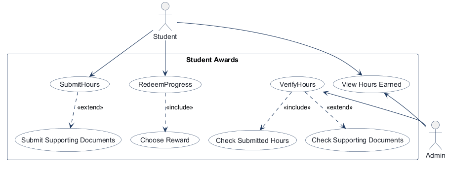
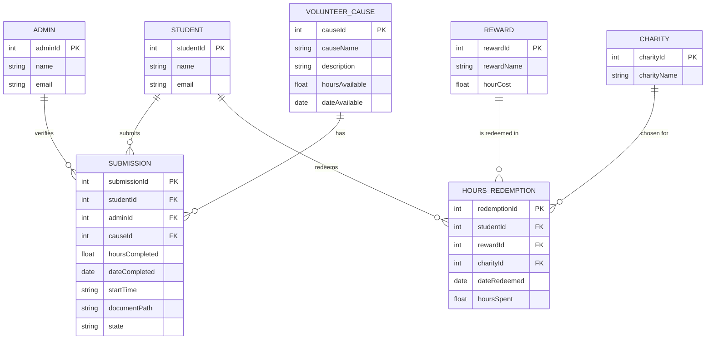
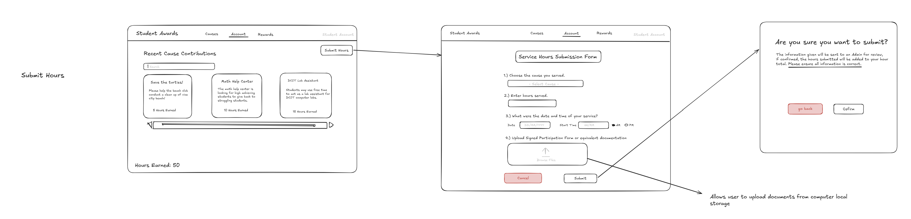
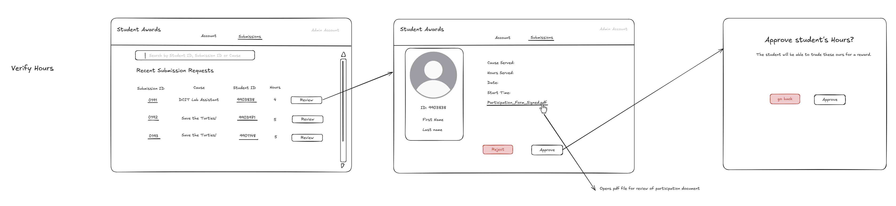
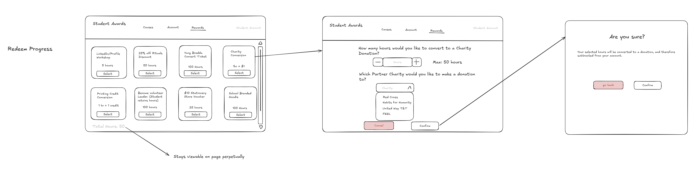

<!-- student-build:skill-integrity
status: pass
root: e84cd692d0b85eefe546385661958c27d07e8be6c5176a82012f68ccff5c8beb
expected_root: e84cd692d0b85eefe546385661958c27d07e8be6c5176a82012f68ccff5c8beb
mismatches: none
-->

# COMP 3613 Assignment 1

Draft this file with the Guide. **Update it after every phase milestone** before you pause. The use-case diagram is a UML PNG at `docs/diagrams/use-case.png`, linked from this file as `diagrams/use-case.png` (path relative to `docs/report.md`). The model diagram is Mermaid. **Embed wireframe images** as `wireframes/<file>` (files live in `docs/wireframes/`).

Do not put your student ID in this file if you will commit it. The PDF cover adds your name and ID at export time.

## Assigned project

Student Awards (incentive system)

## Three workflows

### 1. SubmitHours (Student)

### 2. VerifyHours (Admin)

### 3. RedeemProgress (Student)

## Use case diagram

Notes:
- Actors: Student (left), Admin (right).
- VerifyHours «includes» Check Submitted Hours; extended by Check Supporting Documents.
- SubmitHours is extended by Submit Supporting Documents.
- RedeemProgress «includes» Choose Reward.
- View Hours Earned is shared: Student views their own hours, Admin views all hours.
- Assumed: no Admin approval step for redemptions (Student's choice, per student).

## Model diagram

Revised in Phase 4 from the wireframes (see revision notes below). Update again in Phase 5 when polish revises the model, and note what changed.

Notes:
- Submission holds FKs to Student, Admin, and Volunteer Cause; `state` tracks pending/verified/rejected.
- HoursRedemption is the many-to-many bridge between Student and Reward. The ERD drew it with a composite PK (studentId+rewardId — one redemption per student per reward); **Phase 5 revision (student's call):** repeat redemptions are wanted (a second donation, a second voucher), so the table carries its own `redemptionId` PK instead. `Student.totalHours` sums `hoursSpent` across every row.
- Student.totalHours is **computed** (verified submission hours minus hoursSpent in HoursRedemption), not stored.
- Admin verifies many submissions; a submission is verified by at most one admin (adminId nullable until verified).
- Many submissions can reference one Volunteer Cause (FK causeId on Submission).

Phase 4 revisions (wireframe-derived; student accepted):
- Added `submission.startTime` — Workflow 1 form field 3 (date + AM/PM); Workflow 2 shows `Start Time:`.
- Added `submission.documentPath` — Workflow 1 upload area; Workflow 2 `Participation_Form_Signed.pdf` link.
- Added `volunteer_cause.description` — cause card body text on Workflow 1.
- Added `CHARITY` (charityId, charityName) + nullable `hours_redemption.charityId` FK — Partner Charity dropdown on Workflow 3; student chose a table over a stored string (only charity conversions set it).
- Declined: splitting `Student.name` into first/last — kept as a single `name`.
- Kept `volunteer_cause.hoursAvailable` / `dateAvailable` for a future cause information page (student's note).

Phase 4 workflow clarifications (for Phase 5):
- After Confirm / Approve / Reject the user lands back at the opening screen of that workflow (1 → Account / Recent Cause Contributions; 2 → Submissions list; 3 → Rewards grid).
- Reject asks for a confirmation dialog the same way Approve does.
- Admin sees the student's **total hours earned** — computed, so show the total on the submission review card; no stored field.
- Only Charity Conversion asks for extra input; every other reward's Select goes straight to the confirmation dialog, and all selections require confirmation.

## Wireframes

Student-crafted images, embedded from `docs/wireframes/` (Phase 4).

### SubmitHours — Workflow 1

### VerifyHours — Workflow 2

### RedeemProgress — Workflow 3

Coverage:

<!-- student-build:wireframe-coverage
use_case: SubmitHours
image: docs/wireframes/Workflow 1 - Submit Hours.png
covered: yes
-->

<!-- student-build:wireframe-coverage
use_case: Submit Supporting Documents
image: docs/wireframes/Workflow 1 - Submit Hours.png
covered: yes
-->

<!-- student-build:wireframe-coverage
use_case: VerifyHours
image: docs/wireframes/Workflow 2 - Verify Hours.png
covered: yes
-->

<!-- student-build:wireframe-coverage
use_case: Check Submitted Hours
image: docs/wireframes/Workflow 2 - Verify Hours.png
covered: yes
-->

<!-- student-build:wireframe-coverage
use_case: Check Supporting Documents
image: docs/wireframes/Workflow 2 - Verify Hours.png
covered: yes
-->

<!-- student-build:wireframe-coverage
use_case: RedeemProgress
image: docs/wireframes/Workflow 3 - Redeem Progress.png
covered: yes
-->

<!-- student-build:wireframe-coverage
use_case: Choose Reward
image: docs/wireframes/Workflow 3 - Redeem Progress.png
covered: yes
-->

<!-- student-build:wireframe-coverage
use_case: View Hours Earned
image: docs/wireframes/Workflow 1 - Submit Hours.png
covered: yes
-->

`python manage.py report` also embeds any PNG/JPG still missing from `docs/wireframes/`.

### Workflow 1   Submit Hours

### Workflow 2   Verify Hours

### Workflow 3   Redeem Progress

## Theming

Branding preferences and how they were applied (landing / login / register).

**Preferences (Phase 5, student-stated):**

- **Colors:** Navy Blue, White, Light Blue, Gold
- **Type:** Montserrat (headings and body, weights 400–800)
- **Tone:** clear, supportive, professional without sounding stiff
- **Logo:** graduation-cap mark (gold mortarboard + tassel, cap band adapts to the surface colour) beside the wordmark **Student Awards** — the wordmark taken from the Phase 4 wireframes

**Palette (CSS tokens in `app/static/css/app.css`):**

| Token | Value | Use |
|-------|-------|-----|
| `--brand-navy` / `--brand-sidebar` | `#14395f` / `#0a1f35` | headings, landing + auth backdrop, sidebar |
| `--brand-surface` | `#ffffff` | panels and cards |
| `--brand-accent` | `#c9a227` (gold) | primary buttons, active nav, highlights |
| `--brand-accent-2` | `#5fa2da` (light blue) | gradients and secondary accents |
| `--brand-ink` / `--brand-app-bg` | `#0f2437` / `#f1f5fa` | body text on light, app page background |

**Applied:**

- Graduation-cap lockup built once as `app/templates/partials/logo.html` and included on landing, login, register, and the authenticated sidebar.
- **Landing (`/`):** navy gradient with light-blue and gold glows, wordmark + cap, supportive product copy, and three plain-language points (Submit your hours · Get verified · Redeem progress).
- **Login / register:** white panel with a gold top rule, cap lockup, supportive taglines ("Welcome back — sign in to keep earning." / "Create an account to start tracking your volunteer hours.").
- **Authenticated shell:** tokens carried through — navy sidebar, gold active item, light-blue hover, Montserrat.
- Bootstrap's default blue primary was overridden to gold with navy text for contrast.

**Starter cleanup:** the FastStarter placeholder copy on landing/login/register was replaced with Student Awards brand and product copy. `/config` and auth were kept. The starter's demo user-table page was already removed in `app.js`, and the two placeholder shells `app.html` / `admin.html` were deleted once the workflow screens replaced them (nav and layout follow the wireframes: top bar with **Causes · Account · Rewards**; the admin's top bar is **Account · Submissions**).

## Implementation notes

One named workflow at a time. Include verify notes and polish / model revisions (Phase 5). Do not treat the first build as final.

**Workflow 1 — SubmitHours (Student):** built; student snippets completed and integrated. Awaiting student verification.

Implementation decisions (student picks):

- **Identity:** separate `Student` / `Admin` tables as the ERD draws them, each with a `user_id` FK to the starter `User` login. Model revision: `Student` and `Admin` now carry `user_id` (unique) so login stays on `User`; seed creates both profiles for bob and admin.
- **Document storage:** uploads go to `app/static/uploads/` and are read back at `/static/uploads/<name>` — student's explicit choice to keep it simple. Note: anyone with the URL can open a document; revisit at polish if wanted.

Screens follow the wireframes: Account (cause cards + search + Hours Earned), Submission Form (cause, hours, date + AM/PM, upload), Confirm ("Are you sure you want to submit?" → back to Account). The authenticated shell was switched from the starter sidebar to the wireframe's **top bar** (wordmark · Causes · Account · Rewards · Student Account).

Student snippets (2 of 2 completed in real files):

- `app/models/submission.py` — `Submission` table: all seven ERD fields plus `state`. Student used the ERD's camelCase attribute names directly.
- `app/routers/submit_hours.py` — `submit_hours_confirm`: builds the service, calls `record_submission(...)`, flashes, redirects. **No SQL in the route.**

<!-- student-build:code-check
workflow: SubmitHours
form: choice
layer: other
architecture_ok: yes
implement_confidence: 0.75
passed: yes
note: student chose separate Student/Admin tables (per ERD) and static uploads for simplicity
-->

<!-- student-build:code-check
workflow: SubmitHours
form: choice
layer: other
architecture_ok: yes
implement_confidence: 0.75
passed: yes
note: document storage choice made explicitly by student
-->

<!-- student-build:code-check
workflow: SubmitHours
form: snippet
layer: model
architecture_ok: yes
implement_confidence: 0.80
passed: yes
note: Submission table completed with all ERD fields; naming corrected to snake_case columns
-->

<!-- student-build:code-check
workflow: SubmitHours
form: snippet
layer: router
architecture_ok: yes
implement_confidence: 0.85
passed: yes
note: thin route — binds request, calls service.record_submission, flashes, redirects; no select/db.exec
-->

Model revisions from the Workflow 1 build:

- `submission.state` values recorded as **pending / approved / rejected** (the wireframe buttons say Approve/Reject), replacing the earlier "verified" wording in this report.
- SQLModel columns use snake_case (`student_id`, `hours_completed`, `date_completed`, `start_time`, `document_path`) — the code equivalents of the ERD's camelCase attributes. Diagram left as drawn.
- Fixed on review: FK target typo `vollunteercause.id` → `volunteercause.id`; `default=None` removed from required non-optional fields; `start` → `start_time`; redirect now uses `request.url_for("user_home_view")` instead of a hardcoded (non-existent) `/app/account`.

**Polish round 1 (student verify notes → applied):**

1. Required fields marked with a red asterisk, an "fields marked * are required" note, native `required` blocking submit, plus inline "please fill this in" messages and green valid / red invalid borders.
2. Native `type="time"` always shows its own AM/PM control on Windows, so the Start Time control is now a **hour + minute picker with no meridiem**, leaving the student's AM/PM radios as the only meridiem control. Route binds `time_hour` / `time_minute` and composes `start_time` as `HH:MM AM|PM`.
3. **Submission tracker added to the Account page** (student chose a section over a new nav tab, keeping the wireframe's *Causes · Account · Rewards* bar). Table columns: Submission ID, Cause, Hours, State — with a coloured badge (gold pending / green approved / red rejected). New repository method `by_student` returns every submission regardless of state; service method `my_submissions` attaches the cause name.
4. Dropped the red asterisk from the AM and PM labels — the Start Time label's asterisk covers the control, and both radios stay `required` in the markup.

<!-- student-build:code-check
workflow: SubmitHours
form: snippet
layer: repository
architecture_ok: yes
implement_confidence: 0.85
passed: yes
note: by_student returns every submission newest first with no state filter — correct
-->

<!-- student-build:code-check
workflow: SubmitHours
form: snippet
layer: router
architecture_ok: yes
implement_confidence: 0.75
passed: partial
note: thin route and correct context keys, but called four service methods that do not exist (get_student_by_user_id/get_contributions/get_total_hours/get_submissions); guided to the real names get_student_for/recent_contributions/total_hours_earned/my_submissions
-->

**Workflow 1 status:** closed. The student verified the tracker, the required-field marks, the hour/minute picker, and the AM/PM label change, and confirmed the screen is up to par before moving to Workflow 2.

**Workflow 2 — VerifyHours (Admin):** scaffolded; the two student snippets are marked and waiting.

Screens (built to `docs/wireframes/Workflow 2 - Verify Hours.png`):

- **Queue (`/admin`, Submissions tab):** search box (*Search by Student ID, Submission ID or Cause*) over a *Recent Submission Requests* table — Submission ID, Cause, Student ID, Hours, Review.
- **Review card (`/admin/submissions/{id}`):** student panel (avatar, ID, name, email) beside Cause Served, Hours Served, Date, Start Time, state badge, the student's running total, and the document link — then Reject / Approve.
- **Decision confirm (`/admin/submissions/{id}/decision/{state}`):** "Approve student's Hours?" with the wireframe's *The student will be able to trade these hours for a reward.* copy, a summary of the row, and **go back** / **Approve**.

Implementation decisions (student picks from Phase 5):

- **Review identity:** the `Admin` profile is resolved from the signed-in login and `admin.id` is stored on the submission, so the ERD's "which admin verified it" is kept. The card shows the student's **internal database id** (the project has no `student_number` field).
- **Search runs in the repository** (`SubmissionRepository.pending_queue`, `or_` / `ilike` across cause name and numeric ids) — the router only reads `request.query_params` and passes the string down.
- **Total hours are computed**, never stored: `ReviewService.total_hours_for` sums the student's approved submissions for the card.
- **Queue scope — student chose A: pending only.** The queue is a to-do list; a row leaves it as soon as it is decided, so only unreviewed requests are listed. Decided rows remain visible to the student in their own Account tracker.
- **Queue seed:** `python manage.py init` now seeds a second student (carol), three pending rows across two students, one approved and one rejected row, plus a generated `Participation_Form_Signed.pdf` so the document link opens something real. Re-init is required because the schema gains a column.

Student snippets for this workflow:

- `app/models/submission.py` — **completed by the student:** `Submission` gains `original_document_name: Optional[str] = None`, the name the review card links the document by (the wireframe shows `Participation_Form_Signed.pdf`; `document_path` only holds the generated storage name). Optional, so existing rows stay valid. Service, template, and seeder were aligned to the student's field name.
- `app/routers/admin_home.py` — **completed by the student:** `submission_decision_apply` builds `_review_service(db)`, calls `service.decide(submission_id=…, state=…, user=…)` inside `try/except ValueError`, flashes the service's message on rejection and a success message on acceptance, then redirects to the queue. **No SQL in the route.**

Fix on review: the student's first attempt called `service.record_decision(submission_id, state, user.id)` — a method that does not exist — and raised `HTTPException(400)` instead of flashing. Guided to the real `ReviewService.decide` signature (keyword-only, takes the `User`, not `user.id`); the rewrite passes.

<!-- student-build:code-check
workflow: VerifyHours
form: snippet
layer: model
architecture_ok: yes
implement_confidence: 0.85
passed: yes
note: student added optional original_document_name to Submission so the review card can link the file by its uploaded name; glue aligned to their field name
-->

<!-- student-build:code-check
workflow: VerifyHours
form: snippet
layer: router
architecture_ok: yes
implement_confidence: 0.80
passed: partial
note: thin route (builds service, calls it, redirects; no select/db.exec), but calls service.record_decision(submission_id, state, user.id) — a method that does not exist — and raises HTTPException instead of flashing; guided to the real service signature
-->

<!-- student-build:code-check
workflow: VerifyHours
form: snippet
layer: router
architecture_ok: yes
implement_confidence: 0.85
passed: yes
note: corrected to service.decide(submission_id=, state=, user=); try/except ValueError flashes the service message, success flash, redirect — thin route with no persistence logic
-->

**Workflow 2 verify:** the student ran the app and reported four mismatches against the wireframe (below). Both snippets were already integrated by that point, and the queue / search / review card / approve-reject loop ran end to end.

**Polish round 2 (student verify notes → applied):**

1. **"Submitting with empty required fields shows a code page."** The form tag carried `novalidate="false"` — HTML boolean attributes are true when *present*, so that attribute was silently switching native validation **off** and every empty submit fell through to FastAPI's raw `422` JSON. Attribute removed, so the required-field blocking from polish round 1 actually applies now.
2. **"The document shown is not the document uploaded."** The seeder gave all five demo rows the *same* placeholder PDF, so every review card opened an identical file. `_sample_document` now takes a filename and body per row — each seeded submission gets its own `…-form.pdf` naming the student, cause, date, and hours. Real submissions were already correct: the card shows the student's own uploaded file name and path.
3. **"I can submit hours as an admin."** `/app/hours/new` (GET + POST) and `/app/hours/confirm` now run a `_student_only` guard — an admin is flashed "Hours are submitted from a student account" and redirected to their queue instead of reaching the form.
4. **"Grey out the Student/Admin Account badge."** `.app-account` muted to light grey, smaller size, medium weight — matching the wireframe, which draws *Admin Account* in light grey at the end of the top bar.
5. **Admin Account tab — student chose A: a profile card.** The wireframe's *Account · Submissions* top bar keeps both tabs, so `/app` now branches on role: an admin gets `admin_account.html` (avatar, username, email, `Administrator` badge, link to Submissions) instead of the student dashboard. This also stops the old behaviour of creating a **Student** row for every admin who clicked Account. The hours form and tracker never render for an admin.
6. **Cause list expanded (student request, moving into Workflow 3).** Seeded causes grew from 3 to 8: the original three plus **Beach Cleanup Drive**, **Community Food Bank**, **Library Reading Buddies**, **Blood Drive Volunteer**, and **Campus Open Day Guide**. `python manage.py seed` is additive, so it adds the new rows without touching existing submissions.

**Cause availability (student's addition — Workflow 2 polish):**

- **New rule (student's call):** approving a submission takes its hours off `volunteer_cause.hours_available`. Rejections and pending rows leave the balance alone. If the cause does **not** have enough hours left, the approval is **blocked**: `ReviewService.decide` raises before anything is written, the admin is flashed back to the queue with the shortfall ("DCIT Lab Assistants only has 15 hours left and this approval needs 20…"), and the review card shows the cause's balance with a warning so they can see it coming. Topping up on the Causes page clears it.
- **Admin cause page:** new **Causes** tab at `/admin/causes` — every cause with its remaining hours and an inline *Add hours* form → `POST /admin/causes/{id}/hours` → `CauseService.add_hours` → `VolunteerCauseRepository.adjust_hours`.
- Approvals are visible to students straight away: the Causes page already renders `hours_available` as "N hours available".
- Thin routes throughout: the admin router binds the form and calls the service, which owns the validation (hours must be > 0, cause must exist).

**Workflow 3 — RedeemProgress (Student):** scaffolded; the two student snippets are marked and waiting.

Screens (built to `docs/wireframes/Workflow 3 - Redeem Progress.png`):

- **Rewards grid (`/rewards`):** eight cards (name, hour cost or the conversion rate line), **Select** on affordable cards, a disabled *Needs N hours* button when not (student's choice A), and **Total Hours** persistent at the bottom left.
- **Charity screen (`/rewards/{id}/redeem`, Charity Conversion only):** "How many hours would you like to convert to a Charity Donation?" with a −/+ stepper capped at *Max: N hours*, the partner-charity dropdown, and Cancel / Confirm.
- **Confirmation (`/rewards/{id}/confirm`):** "Are you sure?" with the wireframe's donation copy, a summary (reward, hours, charity, hours left after), **go back** / **Confirm** → POST.

Implementation decisions:

- **Choice A — can't start:** the Select button is disabled on rewards the student cannot afford, and `RedeemService.start` refuses the same pick if someone reaches the URL directly.
- **Only Charity Conversion asks for extra input** (Phase 4 note); every other Select goes straight to the confirmation dialog, and every redemption requires confirmation.
- **Available hours are computed**: approved hours minus `hours_spent` — never stored (`RedeemService.available_hours`).
- Charity screen is its **own page**, as the wireframe draws it; Cancel returns to the grid.
- **Model revision:** `Reward.rate_note` (nullable) — the wireframe's conversion cards show a rate line ("1hr = $1", "1hr = 1 credit") that `reward_name` + `hour_cost` cannot express. Seeded values come straight from the cards.
- **Seed:** the 8 wireframe rewards and the 4 partner charities (Red Cross, Habits for Humanity, United Way T&T, FEEL).

Student snippets for this workflow (2 marked regions, completed by the student):

- `app/models/reward.py` — **completed by the student:** `HoursRedemption` gains `charity_id: Optional[int]` (nullable FK to Charity — only charity conversions set it), `date_redeemed: date` with a `default_factory=date.today`, and `hours_spent: float`. All three are the ERD's remaining attributes in snake_case, matching what the redeem service sets.
- `app/routers/rewards.py` — **completed by the student:** `reward_redeem_apply` builds `_redeem_service(db)`, calls `service.redeem(reward_id=…, user=…, hours=…, charity_id=…)` inside `try/except ValueError`, flashes the service's message and redirects to the grid. **No SQL in the route.**

Fix on review: the student's first attempt fell off the end on success — no flash, no redirect — so a successful redemption returned `None` and the request failed. Corrected on their next pass: success now flashes "Redemption successful!" and redirects to the grid, mirroring the error branch. Both snippets are now clean.

<!-- student-build:code-check
workflow: RedeemProgress
form: snippet
layer: model
architecture_ok: yes
implement_confidence: 0.85
passed: yes
note: student added charity_id (nullable FK to Charity), date_redeemed (default_factory=date.today) and hours_spent to HoursRedemption — the ERD's remaining attributes in snake_case, aligned with what the redeem service sets
-->

<!-- student-build:code-check
workflow: RedeemProgress
form: snippet
layer: router
architecture_ok: yes
implement_confidence: 0.85
passed: partial
note: thin route — builds the service, calls redeem(), try/except ValueError flashes and redirects; no select/db.exec. Missing the success return, so a successful POST returns None; guided to add the happy-path flash + redirect
-->

<!-- student-build:code-check
workflow: RedeemProgress
form: snippet
layer: router
architecture_ok: yes
implement_confidence: 0.90
passed: yes
note: corrected — success now flashes "Redemption successful!" and redirects to the grid; try/except ValueError covers every refusal the service raises; thin route with no persistence logic
-->

**Model revision applied (Phase 5, student's call — repeat redemptions):** the ERD's composite key would have refused a second Charity Conversion with "already redeemed". `HoursRedemption` now carries its own `id` PK (their three fields unchanged), the composite lookup `HoursRedemptionRepository.get` is gone, and `RedeemService.redeem` no longer refuses a repeat. `available_hours` is unaffected — it sums `hours_spent` across every redemption row.

**Workflow 3 verify:** the student completed both snippets, ran the app, and reported everything working end to end — grid, affordability gating, charity stepper, confirmation, and repeat redemptions.

**Polish round 3 (student verify notes → applied):**

1. **"Yung Bredda spelt wrong."** The wireframe card was transcribed as *Ying Bredda Concert Ticket*; corrected to **Yung Bredda Concert Ticket** in the seeder. `init` rebuilds the demo rows — `seed` is additive and would have left the old spelling sitting alongside the new one.
2. **"Add more interesting student rewards."** The seeder grew from 8 to 14: the wireframe's eight plus **Campus Cafe Meal Voucher** (10h), **Library Late-Fee Waiver** (5h), **Gym Day Pass** (8h), **Movie Night Ticket** (12h), **Career Fair Fast-Track Entry** (15h) and **One-Month Parking Permit** (40h) — filling the cost gaps between the cheap conversions and the 100-hour prizes.
3. **"Make rewards and charity tiles look more exciting."** Reward cards became `.reward-tile`: a gold→light-blue gradient top rule, a light-blue wash over the card, a gold-ringed icon medallion, the cost line in gold, and a hover lift with a deeper shadow. The charity dropdown became four `.charity-tile` cards (icon + name) that fill gold when chosen — the form still posts `charity_id`, so the student's route snippet needed no change.
4. **"Make the select button light up when hovered."** `.btn-select` sits as a navy outline on white and fills gold with a soft glow on hover and focus; unaffordable cards use `.btn-select-disabled` (muted, `cursor: not-allowed`).
5. **"Change the Student account badge to Welcome {name}."** The top bar now reads **Welcome, bob** for students, taken from `user.username`. The admin keeps the wireframe's grey *Admin Account*.
6. **"Add a search bar for causes and rewards."** Both pages carry a GET search form (`?q=`) with a Clear button and a "No … match" empty state. Filtering happens in the repositories — `VolunteerCauseRepository.list_all` matches name or description, `RewardRepository.list_all` matches name, both `ilike` — passed through `CauseService.list_causes` / `RedeemService.grid`. The routes only bind `q`; no SQL in routers.

**Polish round 4 (final change, student's call — hours capped at what the cause has):**

- **Rule:** a submission may not claim more hours than the cause currently offers. `SubmissionService.check_hours_fit` owns it and `record_submission` calls it first, so the rule holds however the form is reached. `submit_hours_preview` runs the same check *before* the confirmation screen, and the final POST bounces back to the form with the message if it is ever bypassed. The route also stopped reaching past the service for the cause — `service.causes.get_by_id` is gone from `submit_hours_preview`; the service returns it.
- **UX (student's choice: the same reaction as a missing required field):** the hours input takes the selected cause's balance as its `max`, and a hint under the field reads "N hours available for \<cause\>." Going over sets custom validity, so the browser blocks the POST and shows the same native red bubble and outline an empty required field gets — *"Your hours exceed the total available for this cause — Save the Turtles! has 35 hours."* The inline message under the field swaps to the same text.
- **How it pairs with the approval rule:** only **approvals** spend a cause's hours, so several pending submissions can each fit inside the same balance — it is the admin's approval check (polish round 3) that refuses the later ones. Two halves of one rule: the student is stopped at the cause's balance, and so is the admin.

<!-- student-build:code-check
workflow: VerifyHours
form: choice
layer: router
architecture_ok: yes
implement_confidence: 0.85
passed: yes
note: student chose a profile card for the admin Account tab over dropping the tab or redirecting it to the queue
-->

## Deployed app

Phase 6. Public Render URL (not localhost). Markers open this to mark the three workflows.

**https://faststarter-sbp0.onrender.com/**

Deployed by hand in the Render dashboard from `render.yaml` (blueprint not applied, per the file's own warning):

| Piece | Value |
|---|---|
| Web service | `faststarter` — Python, free plan, Oregon |
| Build | `pip install -r requirements.txt` |
| Start | `python manage.py init --no-drop && python manage.py run --host 0.0.0.0 --port $PORT` |
| Health check | `/health` |
| Database | `faststarter-db` — Postgres 16, free plan, Oregon |
| `DATABASE_URI` | the database's **Internal** URL (Render's `postgres://` prefix is rewritten by `sqlalchemy_uri()` in `app/database.py`) |
| `SECRET_KEY`, `CONFIG_PASSWORD` | generated by Render — never recorded here |
| `ENV` | `production` |

**One change made for the deploy:** `render.yaml` now sets `DB_POOL_SIZE=2` and `DB_ADDITIONAL_OVERFLOW=1`. The app defaults to 10 + 10, and Render's free Postgres allows **5 concurrent connections** — at the defaults the first boot fails with *"remaining connection slots"*. Local development is unaffected; the override only applies on Render.

**Repo note:** the project lives one directory down from the repository root (`comp3613a1-main/comp3613a1-main/`), so the web service's **Root Directory** is set to `comp3613a1-main`.

**What a marker sees on first boot:** `init --no-drop` creates the schema against the fresh Postgres and seeds the demo state — bob on 50 verified hours, 3 pending submissions in the queue, 8 causes, 14 rewards, 4 partner charities.

**Free-tier caveats:** the service sleeps after ~15 minutes idle (first visit takes 20–30s to wake), and free Postgres expires after 30 days. Uploaded documents live in `app/static/uploads`, which is **ephemeral** on Render — they survive until the next redeploy. Fine for marking; not a place to keep records.

## Logins

Every account a marker needs, including extra users you added. Starter accounts:

- bob / bobpass — regular user
- carol / carolpass — regular user (second student, so the admin queue has two to search between)
- admin / adminpass — admin

## YouTube URL

## Session transcripts

Filled when the Guide builds the report: the agent writes chat markdown into `docs/transcripts/`; `python manage.py report` packages them.

Guide packaged **1** chat(s) in `docs/transcripts/` (and `docs/transcripts.zip`).

Index: [docs/transcripts/INDEX.md](transcripts/INDEX.md)

- [`opencode-phase5-6-build-polish-deploy`](transcripts/opencode-phase5-6-build-polish-deploy.md)

## Competency (student-judge)

Filled by Guide from the student-judge run when this report was built.

**Judged at:** 2026-10-12T21:15:00 (local)
**Evidence pass:** re-read live OpenCode chat (Phases 5–6) + current `docs/report.md`, `docs/diagrams/`, `docs/wireframes/` (prior judge.md ignored — this is the first judge run)

# student-judge competency report

**Student / session:** Micah Mitchell (816046428) — COMP 3613 Assignment 1, **Student Awards**
**Artifact:** live OpenCode Guide chat for Phases 5–6, plus `docs/transcripts/opencode-phase5-6-build-polish-deploy.md`. Phases 1–4 ran in earlier Guide chats that are not reachable from this session; their decisions are evidenced through the co-written `docs/report.md` (workflow lines, include/extend answers, entity list, ERD, rendered use-case diagram, three embedded wireframes, Phase 4 clarifications).
**Phases in evidence:** 1–6 (COMP 3613; Phase 5 theme → build → **polish**, Phase 6 Render deploy; never generic Buildmine 0–5)

### Totals

| | Count / value |
|--|--|
| Metrics on rubric | 12 (M1–M12) |
| N/A (excluded) | 0 |
| Metrics scored | 12 |
| Scoreable max | 48 |
| Awarded total | 47 / 48 |
| **Overall (avg of scored)** | **3.9 / 4** |
| Impression mark | 20 / 20 (no sincerity_confidence logged → `round(3.9/4 × 20)`) |

## Scorecard

| ID | Metric | Score / 4 | In avg | Evidence |
|----|--------|----------:|:------:|----------|
| M1 | Phase discipline | 4 | yes | One workflow at a time, each verified before the next; four polish rounds; deploy explicitly gated behind polish — student: *"Ok, everythin works except for one thing I want to change… This is my final change"* before agreeing to Phase 6 |
| M2 | Problem framing | 4 | yes | Unprompted business rule in own words: *"The available hours for a cause should go down for every time a student has their hours confirmed on a cause. Let the admin have a cause page where they can add more hours."* Engaged the edge-case question by choosing blocking over my default. Phases 1–4 framing (workflows as Feature (user), include/extend, entities, theming) evidenced in `docs/report.md` |
| M3 | Decision ownership | 4 | yes | Own calls throughout: approval-block over the offered floor-at-zero; **B** repeat redemptions (which revised their own ERD's composite key); choice **A** affordability gating; the 6-item polish list; the hours-cap UX reference. Agent implemented the how only |
| M4 | Artefact-before-code | 4 | yes | Built to their wireframe; when the ERD's composite PK could not handle a second donation, they chose to change the model rather than accept the limitation. Mismatch hunting against artefacts: *"Yung Bredda spelt wrong"*, *"the new causes weren't added"* |
| M5 | Verification habit | 4 | yes | Verified after every change with specific observed-vs-expected notes — *"Ok, it works great!"*, *"Everything works great"*, *"Everything works well, what is next"*, and the final: *"everythin works except for one thing"*. Ran the full end-to-end walkthrough before deploy |
| M6 | Assignment fit | 4 | yes | Layered throughout: thin routes → services → repositories → models. **No SQL in routers** in any of their three route snippets; cause/reward search filtering sits in repositories and is passed through services. Reused FastStarter auth, nav, and seed. Wireframe-first with documented model revisions |
| M7 | Slice explanation | 4 | yes | Six snippets, two per workflow, all `architecture_ok: yes`. Own-words requirement specs and a precise correction note: *"I change it to add the success path and flash"* — they diagnosed and fixed their own omission. Starter auth internals never questioned (correctly) |
| M8 | Prompt quality | 3 | yes | Substantive prompts were concrete and high quality — the 6-item polish list, and *"let them know [that] their hours are exceeding the total hours available for the cause… similar to how the page reacts when a required field is missing"* (a precise UX spec). Held down to 3 because a majority of turns in this session were minimal transitions — *"Ok, restarted. Lets continue."*, *"Commited and pushed."*, *"Ok, done lets go"* |
| M9 | Response to pushback | 4 | yes | Never accepted the first build. Four polish rounds, each from their own observation; accepted the review finding on their route snippet and corrected it rather than arguing it away |
| M10 | Integrity | 4 | yes | No answer-seeking, no paste dumps, no assistant-voice turns, no meta-laundering signals. Skills untouched (`.agents/skills/` unmodified; export re-verifies hashes) |
| M11 | Provenance continuity | 4 | yes | Everything grew from this thread's artefacts — the charity tiles restyle kept their snippet working (`charity_id` still posted), search went into repositories, the cause page served the rule they wrote |
| M12 | Sincerity trajectory | 4 | yes | No suspicion protocol triggered; no `student-judge:sincerity` blocks. Consistent, reactive, honest turns throughout — including reporting their own snippet gap before I re-raised it |

## Strengths

- **Polish that actually steers.** Four rounds, all student-driven, all from observed behaviour rather than speculation. The rubric's Phase 5 red flag (accepting the first build) is the opposite of what happened here.
- **Architecture respected without being prompted twice.** All three route snippets call a service inside `try/except ValueError` and redirect — no `select()`, no `db.exec()`. When I flagged the missing success return, they fixed it in the right layer.
- **Model revisions they own.** They changed their own ERD's composite key when it could not handle a repeat donation, rather than accepting a limitation in their product.
- **Precise mismatch notes.** *"the new causes weren't added"* and *"Yung Bredda spelt wrong"* are exactly the terse, specific reports the rubric wants — and both turned out to be real (one data, one transcription).
- **Business rules articulated in their words,** not echoed: *"Block the approval until someone tops up the hours."*
- **Discipline at the boundary.** They gated the deploy behind their own final change, then behind my verification.

## Gaps (priority order)

1. **Repository structure (housekeeping, not competency).** The project sits one directory below the repo root (`comp3613a1-main/comp3613a1-main/`) — an artifact of unzipping the starter before `git init`. Render's **Root Directory** had to be set to `comp3613a1-main` to compensate. Harmless for marking, worth flattening before the repo is shared more widely.

No competency gaps survived this evidence pass. Items that would otherwise be listed are cleared: Phase 6 deploy is done with the public URL in the report; Phase 5 verification and polish notes exist across four rounds; Phase 5 `code-check` blocks exist for all six snippets; route architecture is thin.

## Phase gate status

| Phase | Status | Note |
|-------|--------|------|
| 1 | met | Project and three workflows named as `Feature (user)`; evidence in `docs/report.md` |
| 2 | met | Include/extend and shared-use-case answers recorded; UML use-case PNG rendered and embedded |
| 3 | met | Entities and properties named by the student; relationships chosen; ERD later revised on their own call |
| 4 | met | Three wireframes supplied and embedded; unclear paths clarified (Charity Conversion is the only screen asking for extra input; confirmation is mandatory for every reward) |
| 5 | met | Theme applied; three workflows built with two architecture-respecting snippets each; **four polish rounds** with student verification notes |
| 6 | met | Render Postgres + web service deployed from `render.yaml`; public URL and marker logins in the report |

## Recommended next practice

- Weakest scored metric is **M8 (prompt quality)**. Exercise: before asking for a change, write it as a four-line spec — *what* should change, *why* (the observed behaviour), *which screen*, and *what "done" looks like*. The hours-cap request already did this naturally (*"similar to how the page reacts when a required field is missing"*); doing it for the smaller asks would make the record as strong on the minor turns as on the major ones.

## Integrity note

- **Clean.** No answer-seeking, no external-LLM paste-back signals, no capability jumps, no assistant-voice student turns, no meta-laundering. Skills not edited. No suspicion protocol was entered, so no discount was applied to M3/M7/M10/M11/M12.

## Provenance flags

- None. Every build in this session traces to a student decision or artefact recorded earlier in the thread.

## Sincerity log summary

- Blocks found: **0** | max round: **0** | min/mean/final confidence: **n/a** | trend: **n/a** | cleared: **n/a** — no suspicion protocol triggered in any readable chat.

## Skips

- Skips: **0/3 used** in the readable session. No skip was claimed or needed. (Phases 1–4 chats are not reachable from this judge run; no skip can be inferred from them either way.)

## Skill integrity

Course skills are hashed at export and compared to `.agents/skills.lock.json`. Do not edit `.agents/skills/`, `.cursor/skills/`, or `AGENTS.md`.

- Status: **pass**
- Root: `e84cd692d0b85eefe546385661958c27d07e8be6c5176a82012f68ccff5c8beb`
- none
